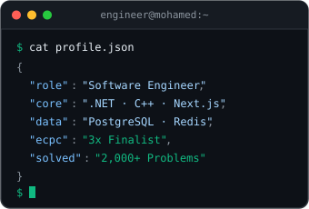

  

<h1 align="center">Hi 👋, I'm Mohamed Mousad</h1>

<h3 align="center">Software Engineer</h3>

  <b>Backend · Distributed Systems · 3× ECPC Finalist</b>

  Building reliable, high-throughput systems with clean architecture and scalable solutions.

---

### 🚀 About Me

<table border="0">
  <tr>
    <td width="60%" valign="top">
      

        <b>Mohamed here</b> — a Computer & Control Engineering graduate (<i>Honours, 87.5%</i>) and <b>3× ECPC Finalist</b> focused on backend systems, distributed architectures, and real-time engineering.
      

      

        I enjoy building scalable, production-ready APIs and real-time engines with <b>.NET (C#)</b>, <b>Clean Architecture</b>, <b>CQRS (MediatR)</b>, and <b>SignalR</b>.
      

      

        Currently engineering systems with <b>ASP.NET Core, PostgreSQL, Redis, Docker, Next.js, and LLMs</b>, backed by strong algorithmic foundations (<b>2,000+ problems solved</b> on Codeforces & LeetCode).
      

      

        My goal is simple: write clean code, design resilient architectures, and build software that stays fast under load.
      

    </td>
    <td width="40%" align="center" valign="middle">
      
    </td>
  </tr>
</table>

---

### 🤝 Connect

  
  &nbsp;&nbsp;
  
  &nbsp;&nbsp;
  
  &nbsp;&nbsp;
  
  &nbsp;&nbsp;
  

---

### 💻 Tech Stack

  
    
  

---

### 📊 GitHub Stats

  

---

### 📈 Activity Graph

  

